# Design Specification & Visual Tokens (Livin' by Mandiri Android)

Dokumen ini memuat spesifikasi desain visual, token warna, tipografi, dimensi komponen, dan struktur layout hasil ekstraksi presisi dari aset referensi asli pada folder `image/`:
1. `icon.jpg`
2. `refferensi.jpg`
3. `referensi2.jpg`
4. `referensi3.jpg`

---

## 1. Palet Warna (Color Tokens)

### 1.1 Warna Utama & Latar Belakang (Brand & Backgrounds)
| Token Nama | Nilai HEX | Penggunaan Visual |
|---|---|---|
| `LivinBlueTop` | `#1A74E2` | Titik awal gradien biru latar belakang layar atas |
| `LivinBlueMid` | `#1464CA` | Titik tengah gradien latar belakang |
| `LivinBlueBottom` | `#0B56BE` | Titik dasar gradien biru latar belakang layar bawah |
| `LivinDeepNavy` | `#0B1B3D` | Warna solid tombol utama **Login** & banner keamanan |
| `LivinGoldPrimary` | `#FDB813` | Kuning emas khas Mandiri pada splash paint 3D & app icon |
| `LivinGoldAccent` | `#F39200` | Shading emas gelap / aksen kedalaman 3D |
| `LivinWhite` | `#FFFFFF` | Teks utama, icon, dan latar belakang lingkaran menu |
| `LivinWhiteTrans70` | `#B3FFFFFF` | Teks sekunder, label intip saldo, disclaimer regulasi |

### 1.2 Warna Komponen Spesifik
| Komponen | Nilai HEX / Karakteristik | Deskripsi Visual |
|---|---|---|
| **Security Alert Pill** | Background `#091E3E`, Border tipis transparan, Teks putih `#FFFFFF` | Rounded container melengkung halus |
| **Badge "BARU"** | Border & Teks `#107C41` / `#00875A` (Emerald Green) dengan background putih semi-transparan | Label pill kecil di atas icon shortcut |
| **Badge "Bebas Pulsa"** | Background `#E53935` (Merah solid), Teks putih tebal | Kapsul kecil di bawah icon Livin' Call |
| **Icon e-money** | Background Lingkaran `#FFB300` (Kuning emas), Kotak dalam `#FFFFFF` | Mengikuti branding kartu Mandiri e-money |
| **Icon Quick Pick** | Background Putih `#FFFFFF`, Petir Cyan/Biru Elektrik `#007AFF` | Shortcut transaksi kilat |
| **Icon Tap to Pay** | Background Putih `#FFFFFF`, Gelombang NFC Cyan `#0091FF` | Fitur pembayaran nirsentuh |
| **Icon Setor Tarik** | Kotak Biru `#0066CC` bersudut membulat dengan koin emas `#FFB300` di tengah | Cardless cash in/out ATM |
| **Carousel Indicator Active** | `#0084FF` (Strip biru cerah memanjang) | Menandai halaman aktif |
| **Carousel Indicator Inactive** | `#B0BEC5` (Abu-abu lembut membulat) | Menandai halaman nonaktif |

---

## 2. Tipografi (Typography)

Menggunakan standar font keluarga Sans-Serif bersih (*Mandiri Sans* / *Inter* / *Roboto*):

| Role / Style | Font Weight | Ukuran (sp) | Warna | Penggunaan |
|---|---|---|---|---|
| **Splash Legal Header** | Regular | 10.5 sp | `#FFFFFF` | Teks regulasi OJK & BI (tengah, multi-baris) |
| **Splash Copyright** | Medium | 11.0 sp | `#FFFFFF` | "Copyright © 2021 Bank Mandiri" |
| **Peek Balance Text** | Medium | 13.0 sp | `#FFFFFF` | "Geser untuk Intip Saldo" |
| **Livin Call Text** | Bold | 11.0 sp | `#0B56BE` | "livin' Call by mandiri" |
| **Livin Call Badge** | Bold | 8.5 sp | `#FFFFFF` | "Bebas Pulsa" |
| **Hero Title Tag** | Bold | 13.0 sp | `#FFFFFF` | Tagline "Kini di Livin'" & "Bisa Pesan Makanan" |
| **Security Title** | Bold / SemiBold | 12.5 sp | `#FFFFFF` | "Pastikan Transaksi Anda Selalu Am..." |
| **Security Subtitle** | Regular | 11.5 sp | `#E0E0E0` | "Hati-hati dengan tawaran mencurigak..." |
| **Quick Action Label** | Medium | 11.0 sp | `#FFFFFF` | Label bawah icon: "e-money", "Quick Pick", dll |
| **Quick Action Badge** | Bold | 7.5 sp | `#00875A` | Badge "BARU" |
| **Login Button Text** | Bold | 16.0 sp | `#FFFFFF` | Teks "Login" pada tombol utama |

---

## 3. Analisis Tata Letak (Layout Hierarchy)

```mermaid
graph TD
    subgraph Layar 1: Splash Screen
        S1[Background Gradien Biru Edge-to-Edge]
        S2[3D Liquid Paint Splash Art Center]
        S3[Logo Livin' by Mandiri Putih Center]
        S4[Disclaimer OJK, BI, LPS & Copyright Footer]
        S1 --> S2 --> S3 --> S4
    end

    subgraph Layar 2: Pre-Login Hub Screen
        P1[Top Bar: Intip Saldo & Livin' Call Badge]
        P2[Header: Logo Livin' by Mandiri]
        P3[Hero Banner: Promo livin' food & Meja Kuning]
        P4[Security Alert: Card Navy Peringatan Transaksi]
        P5[Horizontal Carousel: Shortcut Akses Cepat Hal 1 & Hal 2]
        P6[Pagination Dots & Navigasi Panah Kiri/Kanan]
        P7[Primary Action: Tombol Kapsul Login Biometrik]
        P1 --> P2 --> P3 --> P4 --> P5 --> P6 --> P7
    end
```

---

## 4. Rincian Komponen Sesuai Gambar Referensi

### 4.1 Layar 1: Splash Screen (`refferensi.jpg`)
1. **Latar Belakang:**
   - Fullscreen gradient vertikal dari `#1A74E2` ke `#0B56BE`.
2. **Splash Art:**
   - Visual cat cipratan 3D cair (liquid splash) berwarna kuning emas `#FDB813` di bagian depan dan cipratan biru muda melayang di sekelilingnya.
3. **Logo Brand:**
   - Tulisan *livin'* bergaya tulisan sambung (*cursive*) warna putih dengan titik bulat, diiringi subteks sans-serif *by mandiri*.
4. **Area Legalitas Bawah:**
   - Padding horizontal 24dp, jarak dari batas bawah 32dp.
   - 2 baris teks disclaimer regulasi resmi OJK, BI, dan penjaminan LPS.
   - Baris hak cipta: "Copyright © 2021 Bank Mandiri".

---

### 4.2 Layar 2: Pre-Login Hub (`referensi2.jpg` & `referensi3.jpg`)

#### A. Header & Top Controls
- **Geser untuk Intip Saldo:** Berada di tengah atas dengan 2 panah chevron menghadap ke bawah (`ic_double_chevron_down`). Memberikan petunjuk visual bahwa pengguna dapat melakukan drag/swipe down.
- **Livin' Call Badge:** Berada di sudut kanan atas.
  - Kartu lingkaran putih berdiameter 44dp dengan logo tulisan "livin' Call by mandiri".
  - Kapsul merah di bagian bawahnya dengan teks putih "Bebas Pulsa".
- **Brand Header:** Logo `livin' by mandiri` putih bersih dengan titik kuning khas di atas huruf "i".

#### B. Promo Hero Section (livin' food)
- Foto 3 anak muda ceria di meja makan bulat berwarna kuning menyantap makanan (*food delivery / dine-in*).
- Tagline bertumpuk:
  - Kotak kuning sudut membulat: *"Kini di Livin'"*
  - Kotak oranye: *"Bisa Pesan Makanan"*
  - Kotak biru: *"dengan"*
  - Logo kaligrafi putih: *"livin' food"*
- Smartphone di tengah menampilkan antarmuka pesanan makanan.

#### C. Kartu Peringatan Keamanan (Security Alert Pill)
- Container berbentuk kapsul lebar melengkung (*rounded 16dp*) dengan latar navy pekat (`#091E3E`).
- Di kiri: Teks putih judul dan pesan himbauan waspada transaksi mencurigakan.
- Di kanan: Tombol lingkaran putih berisi panah hitam menghadap ke kanan `->`.

#### D. Carousel Akses Cepat (Quick Access Menu)
Area menu melayang (floating horizontal pager) di atas meja kuning:
- **Tampilan Halaman 1 (`referensi2.jpg`):**
  1. `e-money`: Lingkaran kuning `#FFB300` dengan kotak putih.
  2. `Quick Pick`: Lingkaran putih dengan icon kilat/petir biru `#007AFF`.
  3. `QR Bayar`: Lingkaran putih dengan logo resmi QRIS.
  4. `QRIS Tap`: Lingkaran putih dengan icon QRIS Tap dan badge hijau "BARU".
  5. `QR Terima Transfer`: Tampil sebagian di sisi kanan.
- **Tampilan Halaman 2 (`referensi3.jpg`):**
  1. `QRIS Tap`: Dengan badge hijau "BARU".
  2. `QR Terima Transfer`: Lingkaran putih, logo QRIS dengan kurva kuning, dan badge hijau "BARU".
  3. `Tap to Pay`: Lingkaran putih, icon gelombang kontak NFC cyan, dan badge hijau "BARU".
  4. `Setor Tarik`: Lingkaran putih dengan icon brankas/mesin setor tarik biru & kuning.
- **Navigasi Pagination:**
  - Halaman 1: Strip biru di kiri (aktif), titik abu di kanan, disertai tombol panah bulat kanan `->` untuk next.
  - Halaman 2: Tombol panah bulat kiri `<-` untuk back, strip abu di kiri, strip biru di kanan (aktif).

#### E. Tombol Aksi Utama (Login Button)
- Container kapsul membulat penuh (*pill* dengan corner radius 28dp).
- Warna latar belakang: Biru dongker gelap pekat (`#0B1B3D`).
- Konten: Icon biometrik/sidik jari putih di kiri, teks tebal "Login" warna putih di tengah/kanan icon.
- Margin horizontal: 20dp, margin bawah: 24dp (terintegrasi dengan safe insets navigation bar).
